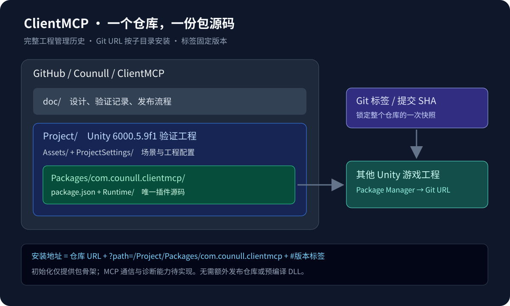
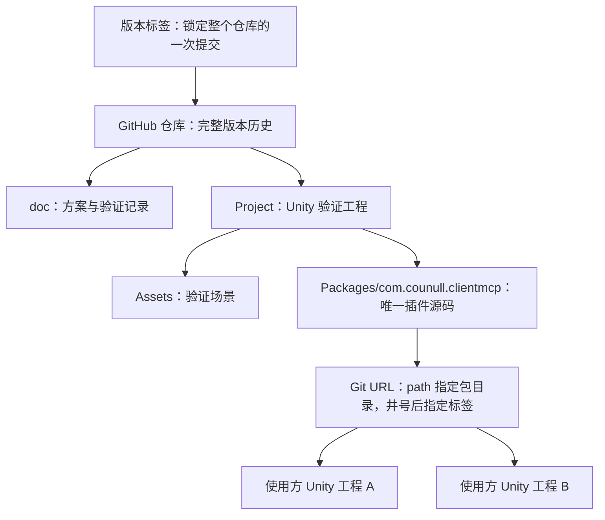

# 工程结构与 UPM 发布流程

## 当前选型

一个 GitHub 仓库维护完整工程历史：Unity 验证场景、项目配置、UPM 源码、设计文档一起提交。UPM 消费者只安装包目录；不需要另建发布仓库，也不需要复制源码到发布分支。

语言为 C#，开发工程使用 Unity 6000.5.9f1，插件以嵌入式 UPM 包位于 `Project/Packages/com.counull.clientmcp/`，包声明最低 Unity 2022.3。首版本机反射接入直接由 Runtime 承载，脚本与 MCP 共用同一个执行器；公网桥接实现与未验收边界，见 [运行时能力与连接方案](remote-diagnostics.md)。





## Git 管理范围

提交 `Assets` 及其 `.meta`、`Packages/manifest.json`、`Packages/packages-lock.json`、嵌入包及其 `.meta`、`ProjectSettings` 和文档。忽略 Library、Temp、Logs、UserSettings、IDE 缓存和构建产物。

开发者克隆完整仓库并打开 `Project/`，直接编辑嵌入包。使用方通过 Git URL 安装后，不应在 `Library/PackageCache` 中维护修改；贡献代码应回到源码仓库。

“管理全部历史”表示所有被提交的源码、资源和文档均有历史，不表示保存缓存、每次按键或未提交内容。即使 UPM 只导入子目录，Git 获取仓库仍可能产生整个仓库的传输成本，因此不要把大型测试素材或构建包混进源码历史。

## Git URL 如何定位包

```text
https://github.com/Counull/ClientMCP.git?path=/Project/Packages/com.counull.clientmcp#v0.1.0
```

- `.git` 之前：完整源码仓库。
- `?path=`：相对仓库根目录的包位置，该目录必须包含 `package.json`。
- `#v0.1.0`：标签，锁定一个提交；也可以使用分支名或完整提交 SHA。
- 顺序必须为 `?path=...#revision`。

在使用方 Unity 中选择 **Window → Package Manager → Install package from git URL**，粘贴地址；也可在使用方 `Packages/manifest.json` 的 `dependencies` 中添加：

```json
{
  "com.counull.clientmcp": "https://github.com/Counull/ClientMCP.git?path=/Project/Packages/com.counull.clientmcp#v0.1.0"
}
```

上面的版本 URL 是发布示例，本次不会创建 `v0.1.0` 标签。初始化快照可使用 `#main`，但它不是稳定版本。

2026-09-30 已在独立 Unity 6000.5.9f1 消费工程实测 `#main` 安装地址：包来源为 `Git`，解析到初始化提交 `4333688`，包注册和编译检查通过，Unity 正常退出。这里的验证不包含 Player 构建或 MCP 功能。

UPM 的 Git 依赖必须写在使用方工程的 `manifest.json` 中，不能在本包的 `package.json` 里用 Git URL 声明另一个包依赖。使用方应安装 Git 并使其可从 PATH 找到。

## 后续发布步骤

1. 日常在 `main` 完成修改与验证；需要隔离开发时使用 `dev`。发布版本前更新 `package.json` 版本及 `CHANGELOG.md`。
2. 在 Unity 验证工程中检查编译和真实功能；发布前再用干净的消费工程验证 Git URL 安装。运行时能力需要额外验证 Player，Editor 成功不代表 IL2CPP 成功。
3. 审查 diff 和公开内容后创建中文 Conventional Commit；本个人项目不强制 PR 或分支保护，日常提交可直接推送。
4. 用户明确授权本次发布和推送后，为发布提交创建不可随意移动的标签。例如版本 `0.1.0` 对应 `v0.1.0`，预览版本可使用 `v0.1.0-preview.1`。
5. 推送对应分支和指定标签。GitHub Release 可选，用于发布说明；Git URL 安装本身只需要远端 Git 引用，不需要上传 DLL 或 `.unitypackage`。
6. 使用方把 URL 中的标签改为新版本，并提交更新后的 `manifest.json` 和 `packages-lock.json`。

以下命令仅说明将来的版本发布流程，不代表已经执行或获得创建版本标签的授权：

```bash
git tag -a v0.1.0 <发布提交SHA> -m "发布 ClientMCP 0.1.0"
git push origin <发布分支>
git push origin v0.1.0
```

`package.json` 的版本号不会自动创建标签，也不会让已安装的 Git 包自动升级。固定标签或 SHA 比浮动分支更便于复现。

## 参考

- [Unity：Git 依赖、子目录与 revision](https://docs.unity3d.com/6000.0/Documentation/Manual/upm-git.html)
- [Unity：Package 目录布局](https://docs.unity3d.com/6000.0/Documentation/Manual/cus-layout.html)
- [当前验证记录](status.md)

## 双端通用核心与 C# 脚本

`Runtime/Core/` 是唯一的通用源码，`ClientMcp.Core.asmdef` 声明 `noEngineReferences`；`DotNet/ClientMcp.Core` 直接编译同一份源码，目标为 .NET Standard 2.0。反射、句柄、操作计划、请求队列、本机 HTTP/MCP 和中转连接不引用 Unity。`Runtime/ClientMcpRuntime` 只负责 Unity 生命周期和 Update，`UnityReflectionHost` 处理场景对象发现、引擎构造限制和已销毁对象判断。

宿主差异只保留在 `IReflectionHost`。普通 .NET 使用 `RegisteredObjectHost` 注册根对象；`find` 默认查已注册根对象，可显式传 `scope=roots`。Core 不枚举托管堆，也不解释业务对象。根对象注销不会自动释放已返回的句柄；使用方应显式 release 或用有效性谓词拒绝失效对象。Unity `scene/loaded` 的发现行为保持不变。

已有 `ClientMcpRuntime.Start/Stop/ConnectRelay` 入口保留；搬迁的公开类型由 Runtime 类型转发。直接创建反射会话的 Unity 使用方应改为 `new ReflectionSession(new UnityReflectionHost())`；无参构造现在使用空的 .NET 根对象宿主。插件外部 HTTP 反射和 plan 格式保持兼容，新增独立 `clientmcp_script` 工具。

### .NET 宿主

引用 `DotNet/ClientMcp.Core/ClientMcp.Core.csproj`；需要 C# 脚本时引用 `DotNet/ClientMcp.Scripting/ClientMcp.Scripting.csproj`。这是项目引用，不复制源码，也不是 `Server/` 中转进程。

```csharp
var roots = new RegisteredObjectHost();
roots.Register("root", applicationRoot);
using var host = new ClientMcpHost(roots);
host.Start(new ClientMcpOptions { InfoPath = privateInfoPath });
// 在创建 host 的线程中周期调用：
host.Pump();
```

创建、启动、Pump、停止均须在同一宿主线程串行执行。`ClientMcpThreadHost` 是可选的 .NET Adapter：创建专用诊断线程、在其中注册对象并 Pump，调用方等待 `Ready`，结束时 Dispose。它不会把业务对象自动变成线程安全对象；房间/Actor 等有执行上下文约束的对象，必须通过宿主已有 PostWork 或安全异步入口封送。无需独立线程的游戏循环直接使用 `ClientMcpHost`。

### 可选 Roslyn 模块

默认不提供编译器，所有 script 请求都被拒绝；反射仍可使用。显式给 `ClientMcpOptions.ScriptCompiler` 传入 `new RoslynScriptCompiler()` 才启用。脚本与反射共享认证、本机监听、对象句柄、宿主执行队列和活动记录。

Unity 开发者克隆完整仓库后运行 `Tools/install-roslyn.ps1`，从固定的官方 NuGet 依赖构建脚本模块并安装到本包 `Plugins/Roslyn`。该目录为本地生成物、不入 Git；普通 Git URL 安装默认只有反射能力，需要脚本时先构建并部署可选模块。安装工具支持 `-UnityPackage <已安装包的可写路径>`，不应直接修改只读 PackageCache。构建 Player 前必须完成模块安装。

Unity Player 加 `--clientmcp --clientmcp-scripts --clientmcp-info <私有文件>`；Editor Play 可调用 `ClientMcpRuntime.Start` 并显式提供编译器。程序集通过反射加载时的名称为 `ClientMcp.Scripting`。IL2CPP 明确拒绝启用脚本；不支持任意动态加载的 AOT 平台不在支持范围。

Roslyn 4.8 编译 C# submission 后使用 `Assembly.Load(byte[])`；避免 Unity Mono 未实现的 `AssemblyLoadContext` 路径。编译在请求线程执行，只有生成的同步委托在宿主队列执行。每次 run 是全新 submission 状态，不延续上次脚本局部变量；需要复用的对象通过根对象或句柄取得。

### 脚本协议与执行语义

`/reflect` 接收 `op=script`，MCP 使用 `clientmcp_script`，两者支持 `prepare/run/result/list/release`。每次操作须有 description；prepare 提供 scriptId/code，run 提供 scriptId/sessionId/operationId 和可选 parameters。新意图新编号，超时重试原编号或查询 result。脚本可使用 `Parameters`、`Get<T>(handle)`；.NET 还可使用 `Root<T>(name)`。返回标量直接编码，其他对象返回同一反射会话的句柄。

脚本最多 65536 字符，每会话最多 32 个已准备脚本、128 条脚本回执；计划缓存保持独立。已成功或失败的 run 都保留回执，原编号不同脚本/参数被拒绝。release 删除脚本及所属回执，结束其去重保证，但不释放对象句柄。编译器复用相同代码，最多加载 128 份不同代码；程序集不能靠 release 卸载，达到上限后须重启宿主再编译新代码。最多同时接受 2 个编译请求，编译器内部串行编译。

脚本仅支持有限、同步、短时操作，拒绝 await/async，返回 Task 也作为失败；调用宿主非阻塞入口不代表其异步工作完成。错误不会回滚此前效果。网络等待超时或断线可取消尚未执行的请求，无法强制停止已经开始的任意脚本；原操作结束后可用 result 查询。请求执行等待超时从编译完成入队后计算，编译期间外部工具可能先超时；prepare 不执行脚本，重试应沿用 scriptId/code。

这是受信任开发入口，不提供进程内沙箱；与宿主同权限。死循环、阻塞、脚本主动派生线程或异常退出都可能影响宿主。同步语法限制不构成安全隔离。日志只记录调用方说明与结果状态，不自动保存代码、参数和返回值；脚本自己输出的日志由脚本作者负责。

参考：[Roslyn CreateScriptCompilation](https://learn.microsoft.com/en-us/dotnet/api/microsoft.codeanalysis.csharp.csharpcompilation.createscriptcompilation)、[Unity AOT 脚本限制](https://docs.unity3d.com/2022.3/Documentation/Manual/ScriptingRestrictions.html)。
